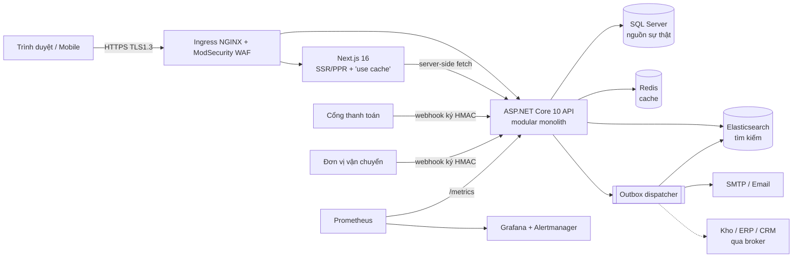
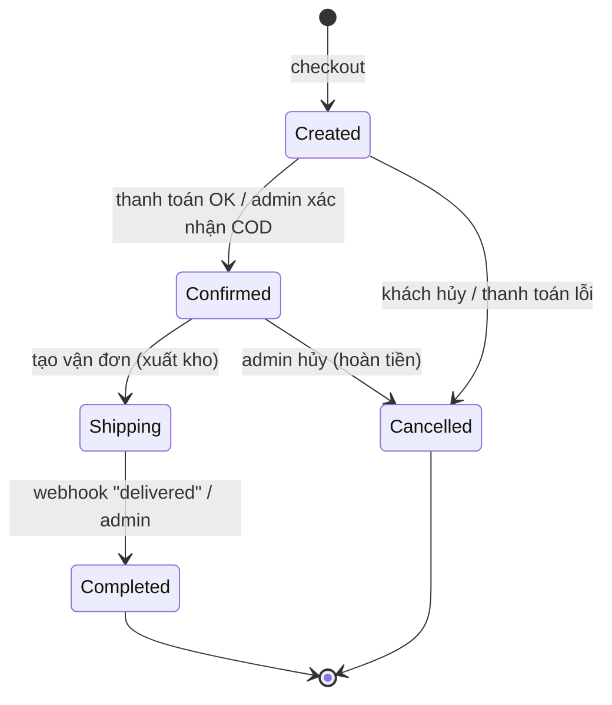

# Kiến trúc kỹ thuật

## 1. Tổng quan



**Quyết định: modular monolith** thay vì microservices ngay từ đầu — một deployable, một DB, ranh giới module rõ ràng (namespace `Modules.*`, giao tiếp qua service + sự kiện outbox). Lý do: đội nhỏ, tránh chi phí phân tán (distributed transaction, tracing, nhiều pipeline). Khi một module cần scale độc lập (vd. Catalog/Search), tách nó ra service riêng: sự kiện outbox đã là hợp đồng tích hợp.

## 2. Module backend (`backend/src/MyShop.Api/Modules`)

| Module | Trách nhiệm | Endpoint chính |
|---|---|---|
| Auth | Đăng ký/đăng nhập, JWT access 15' + refresh token xoay vòng (phát hiện tái sử dụng → thu hồi cả family), hồ sơ, sổ địa chỉ, wishlist, thông báo | `/api/v1/auth/*`, `/api/v1/me/*` |
| Catalog | Danh mục, sản phẩm, variant, đa ngôn ngữ, đa tiền tệ, cache, tìm kiếm (SQL/ES), review, admin CRUD + import CSV | `/api/v1/products`, `/api/v1/categories`, `/api/v1/admin/products` |
| Cart | Giỏ guest/thành viên, gộp giỏ, kiểm tra tồn kho | `/api/v1/carts/*` |
| Orders | Báo giá, checkout (transaction), state machine 4 bước, khuyến mãi | `/api/v1/checkout`, `/api/v1/orders`, `/api/v1/admin/orders`, `/api/v1/admin/promotions` |
| Payments | Webhook thanh toán/vận chuyển (HMAC + timestamp + idempotency), MockPay | `/api/v1/webhooks/*`, `/api/v1/payments/*` |
| Inventory | Đặt chỗ nguyên tử, ledger biến động, điều chỉnh | `/api/v1/admin/inventory` |
| Notifications | Outbox dispatcher → email + thông báo web, reindex search | (background) |
| Reporting | Doanh thu, AOV, CR, LTV, top sản phẩm, theo ngày | `/api/v1/admin/reports/summary` |

API version qua URL (`/api/v1`). Spec: [`docs/api/openapi.json`](api/openapi.json) (sinh tự động từ `/openapi/v1.json`).

## 3. Luồng quan trọng

### 3.1 Checkout & thanh toán

```mermaid
sequenceDiagram
  participant C as Client
  participant A as API
  participant DB as SQL Server
  participant PG as Cổng thanh toán
  C->>A: POST /checkout {cartId, email, address, method, promo}
  A->>DB: BEGIN TRAN
  A->>DB: UPDATE Inventory SET Reserved += q WHERE OnHand-Reserved >= q (mỗi dòng)
  A->>DB: UPDATE Promotions SET UsedCount += 1 WHERE UsedCount < UsageLimit
  A->>DB: INSERT Order(Created), Payment(Pending), Outbox(OrderCreated); Cart.CheckedOut = 1
  A->>DB: COMMIT
  A-->>C: 201 {order, paymentId, paymentUrl}
  C->>PG: redirect tới trang thanh toán (SAQ A)
  PG->>A: POST /webhooks/payments/{source} (X-MyShop-Signature: t=..,v1=HMAC)
  A->>A: verify HMAC + |now - t| ≤ 300s
  A->>DB: INSERT WebhookEvent (unique Source+EventId) → trùng thì bỏ qua
  A->>DB: Payment Succeeded + Order Confirmed + Outbox(OrderStatusChanged)
```

- **Chống oversell**: đặt chỗ bằng `UPDATE … WHERE available >= qty` nguyên tử; 0 dòng bị ảnh hưởng → 409 `insufficient_stock` và rollback toàn bộ.
- **Idempotency**: giỏ chỉ checkout một lần; webhook theo `EventId` duy nhất; trạng thái payment chỉ đổi từ `Pending`.
- **Đối soát số tiền**: webhook `payment.succeeded` phải khớp `Amount`.
- **Thất bại thanh toán** → hủy đơn + giải phóng tồn kho. **Hủy sau khi đã thu tiền** → payment `Refunded` (gọi API refund của cổng thật).

### 3.2 Trạng thái đơn



Mọi chuyển trạng thái ghi `OrderStatusHistory` và phát `OrderStatusChanged` (email + thông báo web).

### 3.3 Đồng bộ dữ liệu (outbox / CDC)

- **Transactional outbox**: sự kiện (`OrderCreated`, `OrderStatusChanged`, `ProductChanged`, `InventoryChanged`, `UserRegistered`) được ghi cùng transaction nghiệp vụ, dispatcher xử lý tối đa 5 lần retry, metric `myshop_outbox_processed_total`.
- **Ledger tồn kho** (`InventoryMovements`) là append-only (event-sourcing style): có thể replay để kiểm toán/dựng lại số dư.
- **Mở rộng**: production publish outbox lên Kafka/RabbitMQ/Azure Service Bus cho WMS/ERP/CRM; hoặc bật **SQL Server CDC** trên `InventoryItems`, `Orders` và dùng Debezium.
- **Elasticsearch** được cập nhật bất đồng bộ từ `ProductChanged`; nếu ES lỗi, `CatalogService` tự fallback sang SQL.

### 3.4 Cache

| Lớp | Cơ chế | TTL / vô hiệu hoá |
|---|---|---|
| Next.js | `'use cache'` + `cacheLife('minutes')`, `cacheTag('catalog')` | phút |
| API list/detail | `IDistributedCache` (Redis), key có **catalog version** | 60s / 5' — admin đổi sản phẩm → bump version |
| API categories/brands | Output cache | 5' |
| Tỉ giá | `IMemoryCache` | 5' |

Redis lỗi không làm hỏng request (đọc/ghi cache được bọc try/catch).

## 4. Frontend (`web/`)

- **Next.js 16 App Router**, `cacheComponents` (Partial Prerendering): static shell phục vụ ngay từ CDN, phần phụ thuộc params/cookie stream trong `<Suspense>`.
- **Atomic design**: `components/atoms` (Button, Field, Price, Badge, Rating, Skeleton) → `molecules` (ProductCard, ProductGrid) → `organisms` (Header, FilterPanel, Gallery, AddToCart, ReviewForm) → pages.
- **i18n**: route `/[locale]` + `proxy.ts` chuyển hướng theo cookie/Accept-Language; dictionary `lib/i18n.ts`.
- **Tiền tệ**: cookie `currency` đọc phía server, truyền vào API.
- **State client**: `ShopProvider` (user, giỏ, tiền tệ); `client-api.ts` tự refresh token khi 401.
- Bộ lọc là `<form method="get">` → hoạt động không cần JS, crawler đọc được.

## 5. Bảo mật & tuân thủ

| Yêu cầu | Hiện thực |
|---|---|
| PCI-DSS | Không bao giờ nhận/lưu số thẻ; thanh toán qua redirect/hosted page (SAQ A); webhook ký HMAC-SHA256 + chống replay |
| AuthN/AuthZ | JWT HS256 ký bằng khóa ≥ 32 byte từ secret store; refresh token lưu **hash SHA-256**; role `Admin` cho `/admin/*`; kiểm tra quyền sở hữu giỏ/đơn |
| Mật khẩu | PBKDF2 (ASP.NET Identity `PasswordHasher`), thông báo lỗi chung chống dò tài khoản |
| Rate limiting | Toàn cục theo IP; `auth` 10/phút (sliding window); `checkout` 20/phút; thêm `limit-rps` tại Ingress |
| Validation & sanitization | DataAnnotations trên mọi DTO (400 tự động), regex cho slug/phone/mã KM, escape `LIKE`, strip HTML ở review, React escape khi render, JSON-LD escape `<` |
| Headers | API: CSP `default-src 'none'`, `nosniff`, `X-Frame-Options DENY`, `Referrer-Policy`, `Permissions-Policy`, COOP/CORP, HSTS; Web: CSP + headers tương tự trong `next.config.ts` |
| TLS | TLS 1.3 tại Ingress (`ssl-protocols: TLSv1.3`); tuỳ chọn `Security:Tls13Only` khi Kestrel tự terminate |
| WAF | ModSecurity + OWASP CRS trên ingress-nginx |
| Logging & dữ liệu cá nhân | Email được che (`j***@example.com`), không log mật khẩu/token; container non-root, read-only FS |
| Supply chain | `dotnet list package --vulnerable`, `npm audit`, Trivy image scan trong CI |

**Lưu ý đã biết (demo)**: token phía web lưu ở sessionStorage/localStorage cho đơn giản. Production nên dùng pattern **BFF**: Next.js route handler giữ refresh token trong cookie `httpOnly; Secure; SameSite=Strict`.

## 6. Triển khai

- **CI/CD** (`.github/workflows/ci.yml`): build + test backend/frontend → build & push image (GHCR) → Trivy → deploy staging → k6 smoke + ZAP baseline → **duyệt thủ công** → production rolling update với tự động `rollout undo` khi lỗi.
- **Kubernetes** (`deploy/k8s`): Deployment + HPA (CPU 65%) + PDB + topology spread, probe `/health/live|ready`, NetworkPolicy, Ingress TLS/WAF. **Canary** tuỳ chọn với Argo Rollouts + AnalysisTemplate dựa trên SLO (`rollout-canary.yaml`).
- **Quan sát** (`deploy/monitoring`): Prometheus scrape `/metrics`, cảnh báo burn-rate SLO, p95 catalog, outbox backlog.
